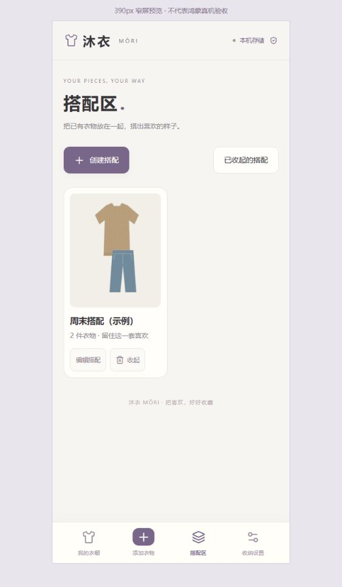
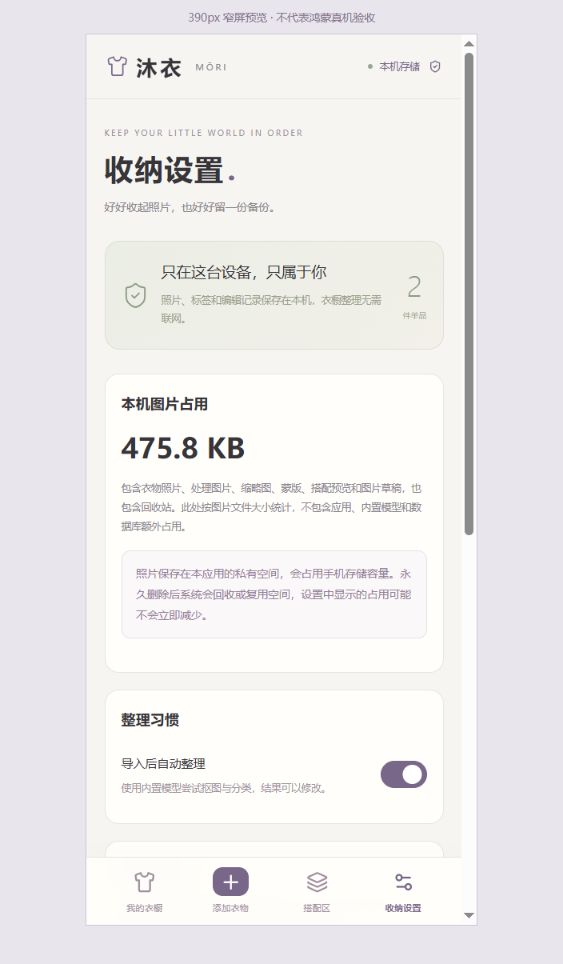
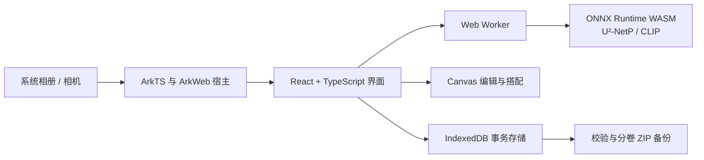

# Yu's Mori · 沐衣离线衣橱

把日常衣物整理成可检索、可编辑、可搭配的个人衣橱。面向 Huawei Mate 80 Pro 的 HarmonyOS 个人项目，使用本地模型完成主体提取和分类建议，照片与标签保存在设备上。

**React · TypeScript · HarmonyOS / ArkTS · IndexedDB · ONNX Runtime Web**

[产品与技术复盘](docs/case-study.md) · [核心数据层](offline/src/store.ts) · [搭配画布](offline/src/looks.tsx) · [鸿蒙工程](harmonyos/) · [模型来源与许可](docs/model-licenses.md)

## 界面预览

<p>
  
  
</p>

截图来自开发预览，衣物为程序绘制的示例素材，不包含个人相册照片。窄屏预览与真机验证分别记录，不把预览截图当作手机实测截图。

## 解决的问题

相册里的衣服照片难以按季节、品类和颜色查找，也很难直观看到已有单品怎样组合。这个项目从实际收纳需求出发，将“导入照片—整理标签—筛选浏览—手动搭配—备份恢复”做成一个无需云端账号的流程。

## 已实现

| 功能 | 实现内容 |
| --- | --- |
| 衣物导入 | 系统相册与相机入口、草稿保存、图片格式和大小校验 |
| 本地图片处理 | U²-NetP 主体提取、裁剪、圈选与画笔修边、亮度/对比度和纯色背景 |
| 整理与筛选 | 5 个主品类、23 个细分类，春秋/夏/冬季节、色系、风格、多维筛选与搜索 |
| 自定义颜色 | 调色板、HEX 值、照片点按取色 |
| 手动搭配 | 最多 12 件衣物，自由拖动、缩放、旋转、图层顺序、背景、保存与编辑 |
| 本机数据 | IndexedDB 保存照片与标签，自动草稿、可恢复回收站、图片占用统计 |
| 永久删除 | 二次确认，关联搭配额外确认；照片与元数据在同一事务中删除，失败回滚 |
| 备份恢复 | ZIP 分卷、图片 SHA-256 校验、重复恢复去重、编号冲突重映射 |

自动识别提供可修改的建议。模型先建议粗分类，23 个细分类由用户确认；复杂背景、透明材质和细肩带可能需要手动修边。

## 技术设计



- **移动端优先**：以触控、窄屏、图片处理等待反馈和系统返回键为主要使用场景。
- **本地推理**：Web Worker 执行模型，支持取消和超时；自动处理失败后仍可继续手动整理。
- **数据一致性**：衣物元数据和四类图片原子保存，修订号避免旧编辑覆盖新记录；删除时重新核对关联关系。
- **升级与恢复**：数据库版本 2 保留版本 1 数据；备份恢复按卷事务回滚，并处理搭配引用的衣物编号变化。
- **离线宿主**：资源打包在应用中，通过固定内部来源加载；不依赖 ChatGPT 网站或付费识别服务。

## 验证与边界

当前版本 **0.2.1**。已有 50 项自动化测试与两套 TypeScript 检查通过，覆盖本地存储、筛选、备份、搭配引用、删除保护和失败回滚；其中 34 项属于离线版，16 项属于早期网页版的通用逻辑。

Huawei Mate 80 Pro 已完成签名覆盖安装，确认相册照片进入编辑页、新品类和搭配入口、系统返回键、图片占用统计与永久删除确认/取消。未用真实衣物执行永久删除测试。完整相机流程、系统 ZIP 导出恢复及更广泛设备兼容性仍需继续验收；自动化数据库测试使用 fake-indexeddb，不能替代全部 ArkWeb 真机验证。

这是个人使用与作品展示项目，**尚未上架应用市场**。当前没有天气接入、自动穿搭推荐、云端同步。仓库中保留早期在线原型代码，但本 README 展示的是 `offline/` 与 `harmonyos/` 中的离线版。

## 本地运行

建议 Node.js 24，包管理器版本见 `package.json`。

```sh
corepack pnpm install --frozen-lockfile
# 首次准备经固定哈希校验的模型（需要联网；不需要付费密钥）
node scripts/prepare-models.mjs
node scripts/prepare-runtime.mjs
corepack pnpm offline:dev
```

访问终端显示的本机地址。公开仓库不包含大型模型权重、生成的 WASM、个人衣物数据库或手机调试签名；模型与运行时按上述步骤准备，部署后在本机推理。上游不可达时可使用 `node scripts/prepare-models.mjs --mirror`，仍校验相同固定哈希。

```sh
corepack pnpm offline:typecheck
corepack pnpm typecheck
node --experimental-strip-types --test offline/tests/*.test.ts tests/*.test.ts
corepack pnpm offline:build
```

鸿蒙打包前，复制 `harmonyos/build-profile.template.json5` 为 `harmonyos/build-profile.json5`，按[鸿蒙工程说明](harmonyos/README.md)在自己的 DevEco Studio 环境配置签名。个人设备调试包不作为通用安装包发布。

## 源码导航

```text
offline/src/       衣橱界面、编辑、搭配、本地存储与备份
offline/tests/     离线版行为与事务测试
harmonyos/         ArkTS 宿主、系统选择器与备份文件桥接
config/           品类、季节、颜色、风格定义
features/image-editor/  图片处理与编辑引擎
workers/          模型推理 Worker
scripts/          模型准备、运行时准备与打包
docs/             设计复盘、验证范围和第三方模型说明
app/              早期在线原型，非当前离线版入口
```

## 项目说明

项目围绕个人日常需求迭代，并借助 AI 编程工具协作实现。展示重点是需求取舍、移动交互、本地推理接入与数据完整性；未宣称自行训练基础模型或取得商业用户数据。

第三方模型和依赖保留各自许可，详见 `docs/model-licenses.md`、`public/model-metadata/` 和 `vendor/`。本仓库公开供作品展示与技术交流，原创代码未另行授予开源许可证。
